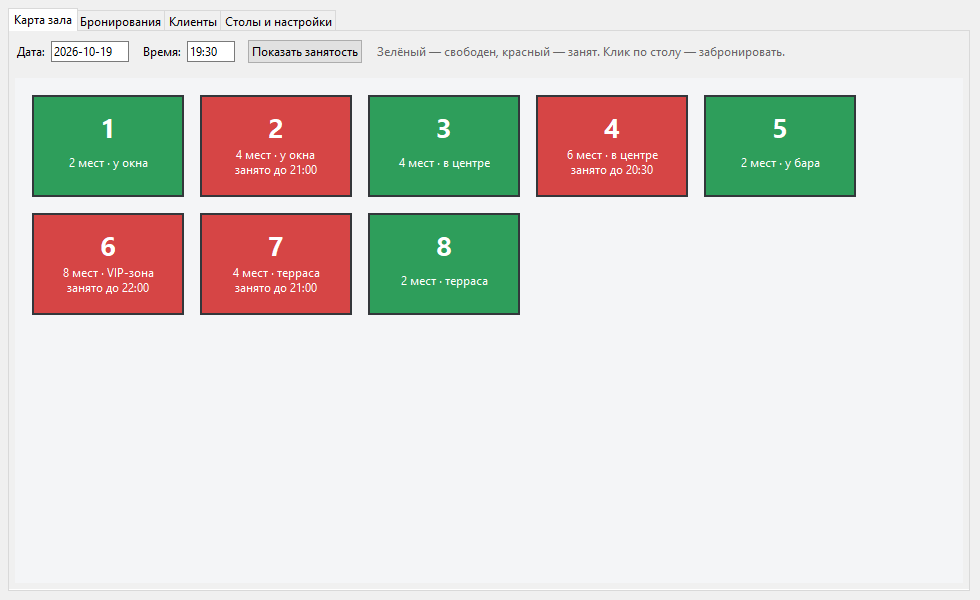
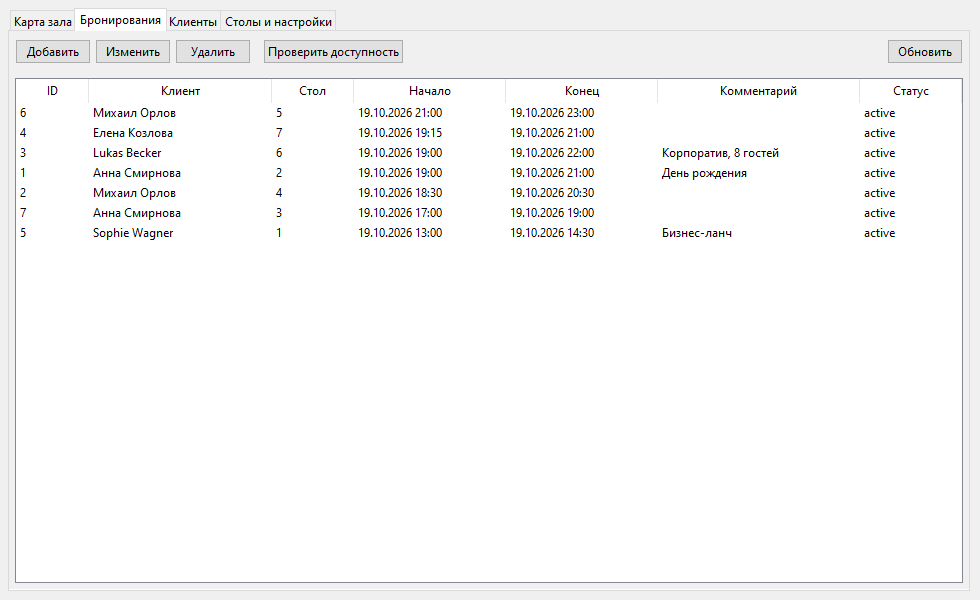

[English](README.md) · **Deutsch** · [Русский](README.ru.md)

# Tischreservierungssystem für Restaurants

Eine Desktop-Anwendung (Python + PostgreSQL) zur Verwaltung von Tischreservierungen
in einem Restaurant. Die Oberfläche ist mit Tkinter gebaut: Raumplan mit farbigen
Tischen, Listen der Kunden, Tische und Reservierungen, Verfügbarkeitsprüfung und
Kontrolle von Überschneidungen.

Die Oberfläche der Anwendung ist auf Russisch; Bezeichnungen der Oberfläche stehen unten auf Russisch mit deutscher Übersetzung.

## Screenshots

**Raumplan** – zur gewählten Zeit belegte Tische sind rot und zeigen das Ende der Reservierung:



**Liste der Reservierungen:**



## 🚀 Schnellstart

**Voraussetzungen:** installiertes Python 3.9+ und ein laufender
PostgreSQL-Server (pgAdmin muss nicht geöffnet werden).

### Windows

1. Projekt herunterladen/entpacken und den Ordner öffnen.
2. Doppelklick auf **`start.cmd`** (oder im Terminal):
   ```
   start.cmd
   ```

### macOS

1. Projekt herunterladen/entpacken und den Ordner im Terminal öffnen.
2. Die Datei einmalig ausführbar machen und starten:
   ```
   chmod +x start.command
   ./start.command
   ```

Das Skript installiert die Abhängigkeiten und startet die Anwendung. **Beim ersten Start**
erscheint im Terminal ein kurzer Assistent: „neue Datenbank anlegen" wählen, einen
Datenbanknamen (z. B. `booking_db`) und das Passwort des Benutzers `postgres` eingeben –
und das Anwendungsfenster öffnet sich. Details in den Abschnitten [Start](#start) und
[Erster Start: Datenbank einrichten](#erster-start-datenbank-einrichten) weiter unten.

> Der Start ist auch manuell möglich: `pip install -r requirements.txt`, danach
> `python app.py`.

---

## Funktionen

- **Raumplan** – Tische als Rechtecke mit Nummer und Beschriftung (Plätze,
  Lage). Grün bedeutet frei, rot belegt. Bei belegten Tischen ist zu sehen, bis
  wann. Ein Klick auf einen Tisch öffnet das Reservierungsformular.
- **Kunden** – Gästeverzeichnis (Name, E-Mail, Telefon). Vollständiges CRUD.
- **Tische** – Nummer, Kapazität, Lage, Aktivität. Vollständiges CRUD,
  schnelles Festlegen der Tischanzahl (1–10).
- **Reservierungen** – vollständiges CRUD, übersichtliche Liste aller Reservierungen.
- **Verfügbarkeitsprüfung** eines Tisches für ein gewähltes Zeitintervall.
- **Kontrolle von Überschneidungen** – eine Reservierung, die sich mit einer
  bestehenden für denselben Tisch überschneidet, kann nicht angelegt werden.
  Direkt aufeinanderfolgende Reservierungen (eine endet genau, wenn die nächste
  beginnt) sind erlaubt.
- **Testdaten** – eine Schaltfläche legt 3 Kunden und 2 Reservierungen für eine Demo an.

## Projektstruktur

```
postgres_driver.py   — Datenbankverbindung, SQL-Ausführung, Anlegen von Datenbank und Tabellen
backend.py           — Geschäftslogik und CRUD, Prüfung von Verfügbarkeit/Überschneidungen
config.py            — Lesen der .env und Konsolen-Assistent für die Ersteinrichtung
models/
  user.py            — Modell User (Kunde)
  table.py           — Modell Table (Tisch)
  booking.py         — Modell Booking (Reservierung)
app.py               — Tkinter-Oberfläche und Einstiegspunkt
requirements.txt
.env.example
start.cmd            — Start unter Windows
start.command        — Start unter macOS
```

Tabellen in der Datenbank: `customers`, `restaurant_tables`, `bookings`.

## Voraussetzungen

- Python 3.9+ (Tkinter ist im Standardumfang von Python enthalten).
- Ein installierter und **laufender PostgreSQL-Server**.

> **Wird pgAdmin benötigt?** Nein. pgAdmin ist nur ein grafischer Client zum
> Ansehen der Datenbank. Die Anwendung verbindet sich direkt mit dem PostgreSQL-Server.
> Es genügt, dass der Serverdienst (`postgresql-x64-…`) läuft – in der Regel
> startet er automatisch mit dem System. pgAdmin muss nicht geöffnet werden.

## Start

### Windows
Doppelklick auf **`start.cmd`** (oder im Terminal):

```
start.cmd
```

### macOS
Die Datei einmalig ausführbar machen, danach per Doppelklick starten:

```
chmod +x start.command
./start.command
```

Das Skript installiert die Abhängigkeiten aus `requirements.txt` und startet `app.py`.
Der direkte Start ist ebenfalls möglich:

```
pip install -r requirements.txt
python app.py
```

## Erster Start: Datenbank einrichten

Beim ersten Start (wenn noch keine Datei `.env` existiert) erscheint im **Terminal** ein Assistent.
Damit unerfahrene Nutzer nicht verwirrt werden, fragt er nur das Nötigste ab:

1. Auswahl: **neue Datenbank anlegen** oder **mit einer bestehenden verbinden**.
2. **Name der Datenbank** (z. B. `booking_db`).
3. **Passwort des Benutzers postgres** – das bei der Installation von
   PostgreSQL festgelegte.

Host (`localhost`), Port (`5432`) und Benutzer (`postgres`) werden mit den
Standardwerten belegt – sie müssen nicht eingegeben werden. Schlägt die Verbindung
fehl (z. B. weil PostgreSQL auf einem anderen Port läuft), bietet der Assistent an,
diese Parameter manuell einzugeben.

Danach:

4. Wurde „anlegen" gewählt, verbindet sich die Anwendung mit der Systemdatenbank
   `postgres` und führt `CREATE DATABASE` aus.
5. Die Parameter werden in `.env` gespeichert.
6. Es wird gefragt, **wie viele Tische angelegt werden sollen (1–10)**.
7. Das Anwendungsfenster öffnet sich.

> **Zum Port.** Der Standardport von PostgreSQL ist `5432`; bei einer normalen
> Installation ist er auf allen Rechnern gleich. Ein anderer Port kommt selten vor:
> wenn mehrere PostgreSQL-Versionen installiert sind oder der Port manuell geändert wurde.

Bei späteren Starts existiert `.env` bereits – der Assistent erscheint nicht, das
Fenster öffnet sich sofort.

> Um die Einrichtung erneut zu durchlaufen (z. B. für eine separate Datenbank),
> die Datei `.env` löschen und die Anwendung neu starten.

## Die Datei .env

```
DB_HOST=localhost
DB_PORT=5432
DB_NAME=booking_db
DB_USER=postgres
DB_PASSWORD=ihr_passwort
```

Eine Vorlage liegt in `.env.example`. Die Datei `.env` wird nicht ins Repository eingecheckt.

## Bedienung

1. Auf dem Reiter **„Столы и настройки" (Tische und Einstellungen)** die Anzahl der Tische
   festlegen und bei Bedarf jeden Tisch bearbeiten (Plätze, Lage). Optional
   **„Создать тестовые данные" (Testdaten anlegen)** klicken.
2. Auf dem Reiter **„Клиенты" (Kunden)** Gäste hinzufügen.
3. Auf dem Reiter **„Бронирования" (Reservierungen)** oder direkt im **Raumplan**
   (Klick auf einen Tisch) eine Reservierung anlegen: Kunde, Tisch, Datum und Uhrzeit wählen.
4. Die Schaltfläche **„Проверить доступность" (Verfügbarkeit prüfen)** zeigt, ob ein Tisch im Intervall frei ist.
5. Im Raumplan Datum und Uhrzeit wählen und **„Показать занятость" (Belegung anzeigen)** klicken –
   die Tische färben sich grün/rot.

## Logik der Überschneidungen

Reservierung A `[a_start, a_end)` und Reservierung B `[b_start, b_end)` für denselben
Tisch überschneiden sich, wenn `a_start < b_end` **und** `a_end > b_start`. Die
Ungleichungen sind strikt, daher sind direkt aufeinanderfolgende Reservierungen
(z. B. 18:00–20:00 und 20:00–22:00) zulässig. Außerdem wird geprüft, dass die
Endzeit nach der Startzeit liegt.
